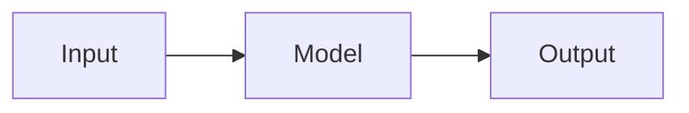

# Amate Labs

Astro site for Amate Labs. It has a one-page mission statement, a blog, and an RSS feed.

## Development

Use Node 22.23.4 or newer.

```sh
npm install
npm run dev
npm run build
npm run preview
```

The Mermaid pipeline renders diagrams to SVG at build time. It needs a Playwright Chromium install:

```sh
npx playwright install chromium
```

## Pages

- `/` landing page
- `/blog/` post index
- `/blog/[slug]/` individual posts
- `/rss.xml` feed
- `/404.html`

## Content

Posts live in `src/content/blog/`. Frontmatter:

```md
---
title: "A post title"
description: "A short summary for the index and RSS."
pubDate: 2026-11-23
draft: false
---
```

Set `draft: true` to hide a post from the index and the feed.

### Math

KaTeX runs at build time through `remark-math` and `rehype-katex`.

```md
Inline: $f_\theta(x)$

$$
\mathcal{L}(\theta) = \frac{1}{N}\sum_{i=1}^{N}(y_i - f_\theta(x_i))^2
$$
```

### Code

Fenced code blocks use Shiki with the `github-light` theme.

### Mermaid

````md

````

## Deployment

Set the `SITE_URL` environment variable when the production origin differs from `https://amatelabs.xyz`.
